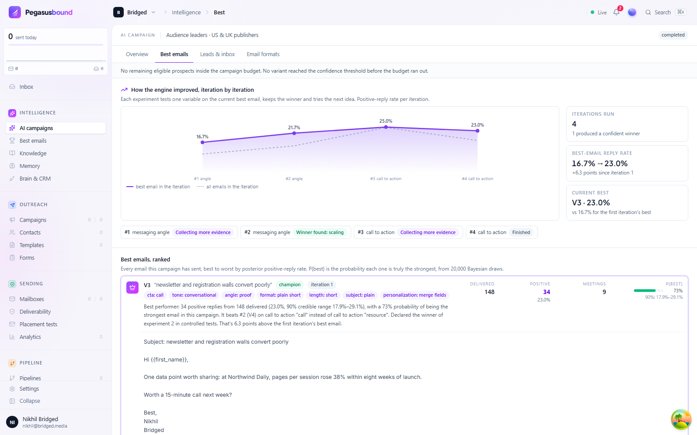
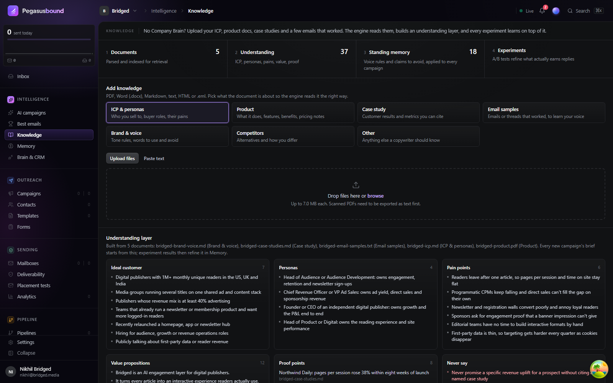

# Pegasusbound

**A cold outbound tool that teaches itself to write better emails.**

Most outreach works like this: someone writes an email, sends it to the whole list and hopes. Pegasusbound works more like a careful scientist. It sends a few versions of an email to a small group, watches who replies and how, keeps the version that works best, then tries to beat it with a new idea. It does this again and again, and it remembers every lesson for the next campaign.

You approve the plan once. The engine does the rest, inside limits you set.



---

## What it does, in plain words

### 1. It learns about your business first

Pegasusbound needs to know what you sell and who you sell to. There are two ways to tell it:

- **Upload your documents.** Your ideal-customer profile, product overview, case studies, brand guidelines and a few emails that worked well. PDF, Word, text and email files all work. Pegasusbound reads them and builds an "understanding layer": who your buyers are, their problems, the results you can prove, the claims you must never make, and how you like to write.
- **Or connect your "Company Brain".** If your company keeps its knowledge in a tool that supports MCP (a standard way for AI tools to read other systems), Pegasusbound can read it directly.

You can also connect your **CRM** (Attio today) to pick who to contact from your existing lists. When someone replies with interest, a follow-up task appears in your CRM.

### 2. You approve once

You say what you want (for example, "book calls with heads of audience at large publishers"), upload or pick a list, and set the limits: how many people in total, how many per day, which days and hours. Pegasusbound proposes a plan and a few draft emails. You can edit them. Then you approve once.

### 3. It runs experiments, round after round

Each round (an **iteration**):

1. **Write:** it writes two or three versions of an email that differ in just one thing, such as the opening angle, the call to action, the subject line or the tone.
2. **Send:** it sends them to a small batch of people through your own mailboxes, with sensible daily limits.
3. **Read:** it reads every reply and sorts it: interested, wants a meeting, not now, not interested, out of office, unsubscribe.
4. **Score:** it works out how likely each version is to be the best, using statistics rather than gut feel.
5. **Decide:** it keeps the winner, drops the losers, and picks the next thing to test.
6. **Remember:** it writes the lesson into memory.

Then it starts the next round from the best email so far. Over time, the emails get better.

### 4. It remembers

Lessons go into a shared **memory**: what works ("emails that lead with a customer result get more replies"), rules to always follow (your brand voice) and things to avoid. Every new campaign starts from that memory instead of from zero.

### 5. It shows its work

- **Best emails:** every email ranked from best to worst, with how many people received it, how many replied positively, meetings booked, and a plain-English explanation of why it ranks where it does.
- **Leads & inbox:** every person in a campaign with the full email thread: what was sent, the follow-ups, and their reply.
- **Email formats:** which tones, angles and styles perform best overall.
- **Memory:** everything the engine has learned, with the evidence behind each lesson.

### Is it safe?

- It only sends within the limits you set, through your own warmed-up mailboxes.
- It pauses itself if bounces or unsubscribes go above a safe level.
- Every email has an unsubscribe link, and anyone who unsubscribes is never contacted again.
- It only makes claims your documents or Company Brain back up, and never uses phrases you've banned.



### A few words you'll see

| Word | Meaning |
|---|---|
| **Iteration** | One round of testing: send a few email versions, measure, keep the best. |
| **Variant** | One version of an email in a test. |
| **Champion** | The best email so far. New ideas have to beat it. |
| **P(best)** | The probability that an email really is the best one, not just lucky. Pegasusbound declares a winner above 90%. |
| **Positive reply** | A reply that shows interest, asks for a meeting, or points you to the right person. |
| **Company Brain** | Your company's knowledge base, if you have one. Optional: uploading documents works too. |
| **MCP** | A standard way for AI tools to connect to other software, such as your knowledge base or CRM. |

### More

- [Product requirements (PDF)](docs/Pegasusbound-PRD.pdf): the full product description, including how the learning works.
- [demo/bridged/](demo/bridged): a sample workspace (a fictional company called Bridged with 1,000 made-up prospects) that shows what the engine produces. Everything in it is dummy data run on a simulation.

---

## Set it up on your computer

This runs the whole product on your own machine. Nothing is sent anywhere unless you connect a real mailbox. Allow about 45 minutes the first time, most of it waiting for the build.

### What you need

| | Why | Get it |
|---|---|---|
| **A computer with 16 GB of memory** (8 GB can work, slowly) and **about 25 GB of free disk space** | The product runs as a group of small programs | |
| **Docker Desktop** | Runs all the parts of Pegasusbound for you | [docker.com/products/docker-desktop](https://www.docker.com/products/docker-desktop/) |
| **Git** | Downloads the code | [git-scm.com/downloads](https://git-scm.com/downloads) |
| **Node.js 22** (optional) | Only needed to load the sample demo data | [nodejs.org](https://nodejs.org/) (choose the "LTS" version) |
| **An Anthropic API key** (optional) | Lets the AI write and read emails for real. Without it, Pegasusbound runs in a practice mode with sample copy | [console.anthropic.com](https://console.anthropic.com/) |

After installing Docker Desktop, open it once and wait until it says it is running.

### Step 1: Download the code

Open a terminal. On Windows that's **PowerShell** (Start menu → type "PowerShell"); on a Mac it's **Terminal** (Applications → Utilities). Then run:

```bash
git clone https://github.com/NikhilJha11/PegasusBound.git
```

```bash
cd PegasusBound/platform
```

All the commands below are run from this `platform` folder.

### Step 2: Create a settings file

Create a file called `.env` inside the `platform` folder (the name starts with a dot and has no other extension). Open it in any text editor (Notepad works) and paste:

```
# Practice mode: no AI key needed. Change to "anthropic" when you add a key.
INTEL_LLM_MODE=mock
# ANTHROPIC_API_KEY=paste-your-key-here

# Let anyone on this computer create an account.
DISABLE_REGISTRATION=false

# Use a free port for link tracking (3000 is often taken by other apps).
TRACKING_PORT=3010
TRACKING_DOMAIN=localhost:3010
```

To use real AI writing later, change `mock` to `anthropic`, remove the `#` in front of `ANTHROPIC_API_KEY`, paste your key, and restart (Step 3 again).

> This file is fine for trying the product on your own computer. Before anyone else can reach your copy over a network, follow [LAUNCH.md](LAUNCH.md) to set proper secret keys.

### Step 3: Start Pegasusbound

```bash
docker compose up -d --build
```

The first time, this builds everything from the code. Expect 15 to 40 minutes, depending on your computer. Later starts take seconds. When it finishes, you'll see a list of parts marked `Started` or `Healthy`.

Check that everything is up:

```bash
docker compose ps
```

You should see `backend`, `web`, `intel`, `postgres` and others with status `running` or `healthy`. If something is `restarting`, wait a minute and check again.

### Step 4: Create your admin account

Get a one-time setup link:

```bash
docker compose exec backend pegasusboundctl setup-link
```

Open the link it prints in your browser and create your account. The first account becomes the administrator.

From then on, open **http://localhost:5173** and sign in.

### Step 5: Try it

1. In the left sidebar, open **Intelligence → AI campaigns** and click **Turn on**.
2. Open **Knowledge** and upload a document about your business, such as a product overview or customer profile. Wait a few seconds and the understanding layer fills in.
3. Go back to **AI campaigns → New AI campaign**. Describe who you want to reach, upload a CSV of contacts (columns like `email, first_name, company, title`), set the limits and create it.
4. Review the plan and the draft emails, then click **Approve**.

To send real email, connect a mailbox under **Sending → Mailboxes** first. The mailbox must support SSL/TLS (Gmail, Outlook and most business email providers do). Use your own test addresses until you're comfortable.

### Optional: load the Bridged demo data

This fills a workspace with the same sample data as the demo video: five documents, 1,000 made-up prospects and six simulated weeks of results. **No email is sent**; the run is a simulation. It needs Node.js 22, and the run step uses PowerShell, which is built into Windows (on a Mac, install PowerShell first: `brew install powershell`).

1. Sign up in the app (http://localhost:5173) with the email you want for the demo workspace.
2. Create a file called `.demo-credentials` in the `platform` folder containing (with your own email and password):
   ```json
   { "email": "you@example.com", "password": "your-password" }
   ```
3. From the main `PegasusBound` folder, install the tools once:
   ```bash
   npm install
   ```
4. Upload the sample documents:
   ```bash
   npx tsx packages/engine/scripts/demo/account.ts
   ```
5. Run the engine on the dummy list (takes about 10 minutes; it pauses the AI part of the app while it runs):
   ```bash
   pwsh -File packages/engine/scripts/demo/run.ps1
   ```
   On Windows you can use `powershell -ExecutionPolicy Bypass -File packages\engine\scripts\demo\run.ps1` instead.
6. Refresh the app and open **Intelligence → Best emails**.

### Everyday commands

Run these from the `platform` folder.

| To… | Run |
|---|---|
| Stop Pegasusbound (your data is kept) | `docker compose stop` |
| Start it again | `docker compose up -d` |
| Get the latest code and rebuild | `git pull` then `docker compose up -d --build` |
| See what's running | `docker compose ps` |
| See error messages from a part | `docker compose logs --tail 100 backend` (or `web`, `intel`) |
| Reset your password | `docker compose exec backend pegasusboundctl user reset-password --email you@example.com` |
| Delete everything and start fresh | `docker compose down -v` (this erases all data) |

### If something goes wrong

| What you see | What to do |
|---|---|
| `docker: command not found`, or "cannot connect to the Docker daemon" | Open Docker Desktop and wait until it says it's running, then try again. |
| "port is already allocated" | Another app is using that port. Close it, or change the port in `.env` (for example `TRACKING_PORT=3010`), then run Step 3 again. |
| The build stops with "no space left on device" | Free up disk space (Docker needs about 25 GB), then run Step 3 again. |
| http://localhost:5173 doesn't load | Wait a minute after starting, then run `docker compose ps`. If `web` or `backend` keeps restarting, look at `docker compose logs --tail 100 backend`. |
| The Intelligence pages say they can't reach the engine | Run `docker compose ps intel`. If it isn't running: `docker compose up -d intel`. |
| A new campaign stays on "Planning" for more than a few minutes | In practice mode planning takes seconds. With `INTEL_LLM_MODE=anthropic`, check that your API key is correct, then restart with `docker compose up -d`. |
| "Could not reach the API" on the sign-in page | The backend isn't up yet. Wait, then refresh. |
| The setup link says it has expired or been used | Run the Step 4 command again for a new one. |
| Docker Desktop shows "An unexpected error occurred" when starting | Choose **Quit** (don't choose "Reset to factory defaults", which erases your data), then start Docker Desktop again. |

---

## For developers

```
platform/          The product: Go backend, React dashboard, workers, realtime, tracking
  internal/app/intelsink/                     campaign events → intelligence outbox
  internal/api/handler/intelligence_proxy.go  /v1/intel/* → intelligence sidecar
  web/src/app/app/intelligence/               AI campaigns, best emails, knowledge, memory, leads, formats
packages/engine/   The intelligence layer (TypeScript): experiments, Bayesian decisions,
                   document knowledge, memory, MCP clients, Claude
apps/intel/        HTTP sidecar exposing the engine to the backend; runs the job loop
demo/              Bridged sample documents, demo output and the demo video sources
docs/              Product requirements (Markdown and PDF), images
scripts/brand/     Brand assets, icon rendering, screenshot and video tooling
```

### How the parts fit together

```
Browser ── /v1/* ──► Go backend ──────────────► Postgres (platform schema)
                     │  /v1/intel/* (session-authenticated,     ▲
                     │   HMAC-signed org/user identity)         │ intel schema
                     ▼                                          │
                  intel sidecar (Node) ── jobs, experiments, memory ──┘
                     │   ▲
   POST /v1/campaigns│   │ intelligence_event_outbox
   POST /v1/contacts │   │ (sent, reply, bounce, unsubscribe, meeting)
                     ▼   │
                  Go backend → workers → your mailboxes (warm-up, caps, stop-on-reply, unsubscribe)
```

- **Sending:** every experiment arm becomes a native platform campaign with its follow-ups as steps, so the platform's mailboxes, warm-up, daily caps, threading, stop-on-reply, unsubscribe and suppression all apply.
- **Learning:** the backend appends campaign events to a durable outbox in Postgres; the sidecar drains it into the learning loop.
- **Decisions:** Beta-Binomial posteriors per variant, seeded Monte Carlo P(best), 90% credible intervals, staged batch sizes, scale/retire thresholds and a practical-equivalence rule. The LLM explains decisions; it never makes them.
- **Tenancy:** every engine row is scoped to a platform organization; the sidecar trusts only identities signed by the backend.

### Develop

```bash
npm install
npm test             # engine (full learning loop, documents, tenant isolation, platform bridge) + sidecar API security
npm run typecheck
```

When changing engine tables, run `npm run db:generate` in `packages/engine`. It also strips drizzle's `"public".` qualifiers, which must stay out because the engine lives in its own schema.

Going live for other people: see [LAUNCH.md](LAUNCH.md).

## Licence

`platform/` is built on an Apache License 2.0 codebase. The original `LICENSE` and the [`NOTICE`](platform/NOTICE) of modifications must ship with every distribution.
